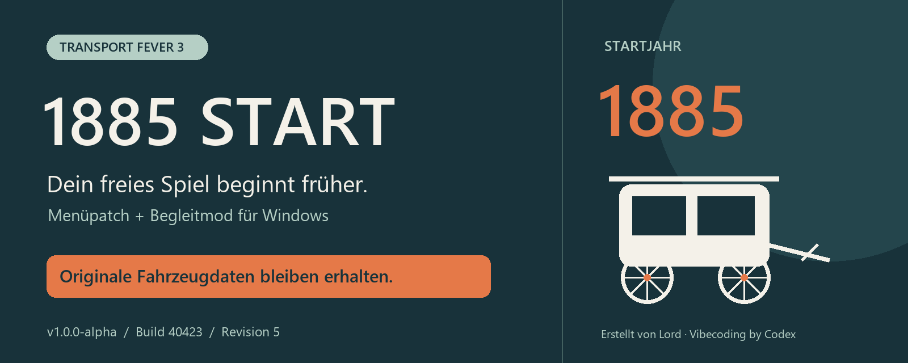
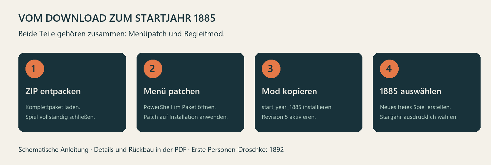

<p align="center"></p>

<p align="center"><strong>v1.0.0-alpha · Windows · geprüfte Spieldateien: Build 40423 · Begleitmod: Revision 5</strong></p>

<p align="center">
  <a href="https://github.com/LordTheFirst/tf3-startjahr-1885/releases/tag/v1.0.0-alpha"><strong>Komplettpaket herunterladen</strong></a> ·
  <a href="docs/TF3_1885_Anleitung_DE.pdf">PDF-Anleitung</a> ·
  <a href="docs/README_EN.md">English</a> ·
  <a href="https://github.com/LordTheFirst/tf3-startjahr-1885/issues/new/choose">Fehler melden</a>
</p>

# 1885 Start für Transport Fever 3

Starte ein neues freies Spiel im Jahr **1885**. Ein lokaler Menüpatch erweitert die Startjahrauswahl; der Begleitmod „1885 Starthilfe“ stellt frühe KI-Kutschen, Depots, Wartungsgebäude und Straßenterminals bereit. **Kaufbare Fahrzeuge behalten ihre ursprünglichen Werte und Freigabejahre.**

Erstellt von **Lord**. **Vibecoding by Codex.**

> **Alpha:** Für Windows und die exakt geprüften Spieldateien aus Build 40423. Andere oder bereits anderweitig veränderte Dateien werden abgewiesen. Offline-Prüfungen sind bestanden; der vollständige Spieltest einschließlich Be-/Entladen, Wartung und Speichern/Laden steht aus. Für Tests eine separate Speicherkopie verwenden.

## Was du herunterladen solltest

Lade unter [Releases → v1.0.0-alpha](https://github.com/LordTheFirst/tf3-startjahr-1885/releases/tag/v1.0.0-alpha) die Datei **`TF3_1885_Start_Windows_Komplett_1.0.0-alpha.zip`** herunter und entpacke sie vollständig. Darin liegen Menüpatch, Begleitmod und die deutsche PDF. Kein Python erforderlich.

Die automatisch von GitHub angebotenen Dateien **„Source code (zip/tar.gz)“ sind nicht das Windows-Komplettpaket**. Verwende den ausdrücklich benannten Download oben.

## So installierst du es



1. **Entpacken und TF3 schließen.** Im Paket zuerst `anleitung_de.pdf` lesen.
2. **Menüpatch anwenden.** PowerShell im entpackten Paketordner öffnen und ausführen:

   ```powershell
   powershell.exe -NoProfile -ExecutionPolicy RemoteSigned -File .\menu_patch.ps1 -Mode apply
   ```

   Den abgefragten Spielinstallationsordner mit `TransportFever3.exe` angeben. Bei Steam findest du ihn über die Verwaltung des Spiels und „Lokale Dateien durchsuchen“. Gemeint ist die Installation, nicht der `userdata`-Ordner. Wenn Windows das heruntergeladene Skript blockiert, nach Prüfung in seinen Dateieigenschaften gegebenenfalls **„Zulassen“** auswählen. Der Spielordner muss beschreibbar sein.
3. **Begleitmod installieren.** Den vollständigen Ordner `start_year_1885` nach `<Steam-Ordner>/userdata/<Konto-ID>/3493540/local/mods/` kopieren. Den bisherigen Begleitmod deaktivieren und dessen alten Ordner aus dem Modbereich herausnehmen. Doppelte Fassungen vermeiden; eine Entwicklerversion in `staging_area` hat Vorrang.
4. **Neues freies Spiel erstellen.** „1885 Starthilfe“, Revision 5, aktivieren und das Startjahr ausdrücklich auf **1885** stellen. Den alten „Start Year 1850“-Kalenderprototyp deaktiviert lassen.

Die [PDF-Anleitung](docs/TF3_1885_Anleitung_DE.pdf) enthält die ausführlichen Schritte, schematische Abbildungen und den Rückbau. Eine kopierbare [Textanleitung](package/readme_de.md) liegt ebenfalls bei.

## Was sich ändert

| Bereich | Verhalten |
| --- | --- |
| Freies Spiel | Menüauswahl ab 1885; Jahresschritte von 5 Jahren |
| Privater KI-Verkehr | Drei originale KI-Pferdekutschen ab 1885 |
| Depots und Wartung | Jeweils erste Bauvorlage von sieben Gebäudetypen ab 1885 |
| Straßenterminals | Erste Personen- und Universal-Güterterminal-Vorlagen ab 1885 |
| Kaufbare Fahrzeuge | Originale Werte und Verfügbarkeitsjahre |

Zu den Gebäuden gehören Straßen- und Straßenbahndepot, Straßen-Fahrzeugwartung, Bahndepot und Bahn-Fahrzeugwartung sowie Werft und Schiffs-Fahrzeugwartung. Spätere Gebäudestufen bleiben erhalten.

**1885 gibt es bereits die kleine Güter-Pferdekutsche. Die erste Personen-Droschke wird weiterhin erst 1892 kaufbar.** Der Mod zieht diese Fahrzeugfreigaben nicht vor.

Kleine Straßenhaltestellen können Güter regulär nur **entladen**. Zum Abholen von Gütern brauchst du ein **Universal-Güterterminal** und ein für die Ware geeignetes Fahrzeug. Personenverkehr setzt ein verfügbares Personenfahrzeug voraus.

## Warum Menüpatch und Mod zusammengehören

Die Startjahrauswahl liegt im Spielmenü. Der Menüpatch ändert lokal den Eintrag in `base/content/gui.zip`. Der Begleitmod wird für das frühe Spiel benötigt und erweitert ausgewählte Verfügbarkeiten. Ein Mod-Abonnement allein ändert die Menüauswahl nicht.

Das Patchwerkzeug prüft die Prüfsummen des Archivs und des Inhaltsverzeichnisses, legt eine Originalsicherung an und akzeptiert ausschließlich das geprüfte Original oder den geprüften 1885-Patch. Grundspielarchive, Modelle oder Texturen werden nicht mitgeliefert. [Technische Beschreibung](docs/TECHNIK.md)

## Prüfen und zurücksetzen

TF3 schließen und im entpackten Paketordner denselben Befehl mit dem gewünschten Modus ausführen:

```powershell
# Nur prüfen – verändert keine Dateien
powershell.exe -NoProfile -ExecutionPolicy RemoteSigned -File .\menu_patch.ps1 -Mode inspect

# Ursprüngliche Menüauswahl ab 1900 wiederherstellen
powershell.exe -NoProfile -ExecutionPolicy RemoteSigned -File .\menu_patch.ps1 -Mode restore
```

Das Zurücksetzen betrifft das Menü. Der Begleitmod wird dadurch nicht entfernt. Das Entfernen des Begleitmods aus einem Spiel vor 1900 und die Kompatibilität vorhandener Spielstände sind ungeprüft.

Spielupdates oder eine Steam-Dateiprüfung können den Menüpatch zurücksetzen. Bei unbekannten Spielversionen erst eine passend geprüfte Aktualisierung dieses Projekts abwarten.

## Häufige Fragen

**Es steht weiterhin 1900 im Menü.** Prüfe den Menüpatch mit `-Mode inspect` und ob du die richtige Spielinstallation angegeben hast. Für ein neues Spiel muss 1885 ausdrücklich ausgewählt sein; der Mod allein ändert das Menü nicht.

**Depots fehlen.** Prüfe, ob Revision 5 aktiv ist. Alte Modkopien und eine abweichende Fassung in `staging_area` können die gewünschte Fassung verdrängen.

**„Unsupported … Nothing changed.“** Die Dateien entsprechen nicht dem geprüften Stand. Der Patch bricht ab, ohne unbekannte Dateien zu überschreiben. [Fehlersuche](docs/FEHLERSUCHE.md)

**Kann ich das direkt im ModHub installieren?** Dieses Windows-Komplettpaket gehört zum externen GitHub-Download. Es enthält ein separates PowerShell-Werkzeug. Ein reiner Begleitmod ersetzt den Menüpatch nicht. Eine ModHub-Freigabe ist nicht bestätigt.

## Rückmeldungen und Weiterentwicklung

Bitte melde Probleme über die [Issue-Vorlage](https://github.com/LordTheFirst/tf3-startjahr-1885/issues/new/choose). Hilfreich sind Spielbuild, Modrevision, Startjahr, genaue Schritte und die relevante Stelle aus `stdout.txt`. Private Pfade und persönliche Angaben vor dem Hochladen prüfen.

Nächste Prüfpunkte sind der vollständige Spieltest, Güterbe- und -entladung, Wartungsbetrieb und Speichern/Laden. [Änderungsverlauf](CHANGELOG.md) · [Mitwirken](CONTRIBUTING.md)

## Dateien und Credits

`package/` enthält das ausgelieferte Windows-Paket als Einzeldateien, `docs/` die Anleitung und eigene Grafiken und `tools/` das reproduzierbare Packwerkzeug. Die Grafiken sind schematische Illustrationen, keine Spielaufnahmen. Der Release-ZIP ist bytegleich zum bereits veröffentlichten Alpha-Paket; Prüfwerte liegen unter `checksums/`.

**Erstellt von Lord. Vibecoding by Codex.** Ein Community-Projekt für Transport Fever 3; keine offizielle Veröffentlichung von Urban Games. Keine Lizenz festgelegt. Die Rechte an Transport Fever 3 und seinen Spielressourcen verbleiben bei den jeweiligen Rechteinhabern.
